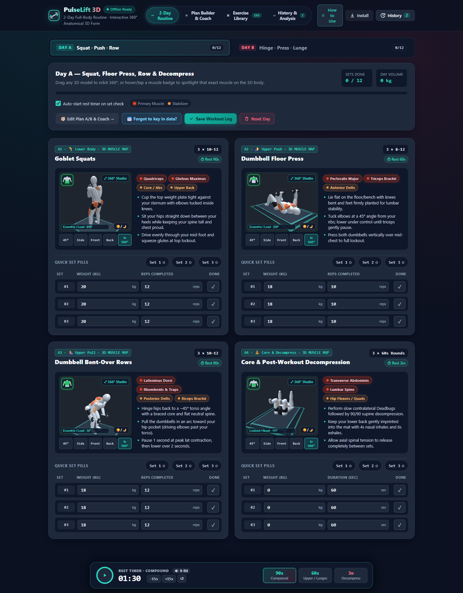
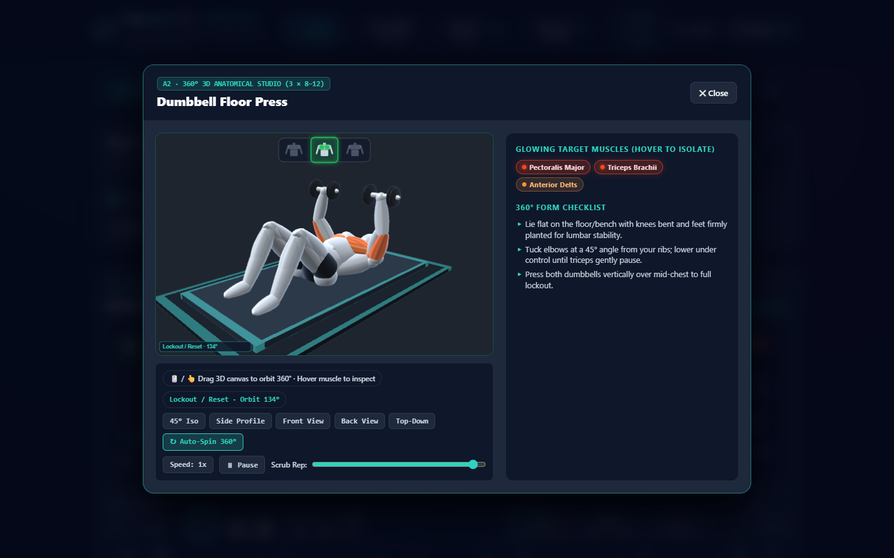

# PulseLift — Code Report: Current Version and Proposed Update

Date: 16 November 2026 · Version reviewed: v19 (cache name `pulselift-workout-v19`)

Status: the current version is documented and snapshotted. The proposed update has **not** been built yet — the first step (a one-exercise prototype) is next. See [TO-BE-CONTINUED.md](../TO-BE-CONTINUED.md).

---

## 1. Summary

PulseLift is a workout tracker that runs entirely in the browser. It logs a 2-day full-body routine, has a rest timer, a plan builder, a 165-exercise library and a 3D figure that shows which muscles each exercise works.

The 3D figure is built from basic shapes (spheres, boxes and tubes), so it reads as a jointed doll rather than a person. The proposed update replaces it with a real rigged human mannequin whose muscles glow, and turns each exercise into a form guide detailed enough that the user does not need a video.

| | Current (v19) | Proposed |
|---|---|---|
| 3D body | Spheres, boxes and tubes joined at the joints | One continuous rigged human mesh (grey mannequin) |
| 3D engine | Hand-written WebGL, 3,331 lines | Three.js |
| Muscle display | Coloured shapes placed on the body | Heat glow on the skin itself, primary strong, secondary faint |
| Form guidance | 3 text cues per exercise, camera presets, rep scrubber | Phase-by-phase cues, right/wrong comparison, joint callouts, tempo and breathing |
| Structure | One page, views switched by hash | One URL per exercise, code split into modules |
| Phone layout | Overflows sideways (see 2.6) | Designed phone-first |

---

## 2. Current version (v19)

### 2.1 Files

| File | Lines | Size | Role |
|---|---|---|---|
| `index.html` | 730 | 40 KB | All four views and three modals in one page |
| `style.css` | 3,667 | 75 KB | All styling |
| `script.js` | 5,984 | 278 KB | App logic, storage, UI rendering, and the full exercise library data |
| `anatomical3d.js` | 3,331 | 119 KB | The WebGL 3D engine and all exercise poses |
| `sw.js` | 96 | 3 KB | Service worker (offline support) |
| `server.py` | 198 | 8 KB | Local server on port 8765 with disk backup |
| `manifest.json`, `icon.svg` | — | — | Installable-app metadata |

There is no build step, no framework and no external library. Everything is plain HTML, CSS and JavaScript.

### 2.2 Views

Screenshots of every view are in [snapshot-v19-2026-11-16](snapshot-v19-2026-11-16/README.md).

| View | Hash | What it does |
|---|---|---|
| 2-Day Routine (tracker) | `#tracker` | Day A / Day B tabs, 4 exercise cards each with a 3D viewer, cues, and 3 sets of weight × reps to tick off |
| Plan Builder & Coach | `#planner` | Pick available equipment, check the plan stays moderate (3–5 exercises, 9–15 sets), reorder or swap exercises |
| Exercise Library | `#library` | 165 exercises in 5 sections, filter by clicking a muscle on a body, search, equipment and difficulty filters |
| History & Analysis | `#history` | Logged workouts, filters and volume summaries |

Modals: 360° Studio (large 3D viewer), tutorial with guided tour, and "Forgot to key in data?" backfill for logging a past date. A rest timer bar is fixed at the bottom.

### 2.3 How the 3D figure works now

- `anatomical3d.js` creates its own WebGL shaders and three mesh types: a unit sphere, a unit box and a "loft" (a tube whose two ends can have different widths).
- Each exercise has a *pose builder*: a function that takes the rep progress (0 to 1) and returns the 3D position of each joint — pelvis, chest, neck, head, hips, knees, ankles, toes, shoulders, elbows, wrists.
- The body is drawn by stretching lofts between those joints and putting spheres at the joints. Muscles are extra coloured shapes placed over the limbs.
- There are 36 pose builders. The 165 library exercises share them through a `poseId` field (34 distinct pose IDs are in use), so many exercises reuse the motion of a similar one.

This design is why the body cannot look human: there is no continuous skin, only separate shapes meeting at joints. It is also why the motion data is worth keeping — the pose builders already describe where every joint goes during a rep.

### 2.4 Exercise data

Each library entry is created by `makeEx(...)` in `script.js` and holds: section, order code, id, pose id, equipment, name, prescription (e.g. 3 × 10–12), mechanic (compound/isolation), difficulty, primary muscles, secondary muscles and three form cues.

There are 15 muscle groups: pecs, front/side/rear delts, biceps, triceps, forearms, core, quads, hamstrings, glutes, calves, lats, upper back, lower back.

### 2.5 Storage and backup

Workout data is kept in several places so it survives a cleared cache:

1. `localStorage` (state, history, a shadow copy of history, and backup snapshots)
2. IndexedDB (`PulseLiftVaultDB`)
3. `window.name` (survives a reload in the same tab)
4. Disk, through `server.py`: `GET/POST /api/backup` writes `workout-backup.json` and rolling daily files in `backups/`

On start-up the app merges all sources and writes the result back. Export and import of a JSON backup file is also available.

### 2.6 Problems found

| # | Problem | Evidence |
|---|---|---|
| 1 | The figure looks like joined shapes, not a person | Section 2.3; the reason for this update |
| 2 | Phone layout overflows sideways | At 390 px wide the page lays out 974 px wide. The header navigation is cut off and modals open mostly off-screen (phone screenshots 08 and 09) |
| 3 | The library page is extremely long | 41,392 px tall on desktop and 121,324 px on a phone, with every exercise rendered at once |
| 4 | All logic and data are in one 278 KB file | `script.js` mixes storage, rendering, the timer, the planner and 165 exercises of data, which makes changes risky |
| 5 | Form guidance is thin | Three one-line cues per exercise; nothing about common mistakes, tempo or breathing |
| 6 | Many exercises share a pose | 165 exercises, 34 poses — some animations only approximate the named exercise |
| 7 | The working folder is not under version control | `D:\CODES\workout-tracker` has no git; the GitHub clone is a separate folder with identical files |

Problem 2 was measured in phone emulation in headless Chrome. It should be confirmed on a real phone.

### 2.7 What is good and should be kept

- The tracker flow: tick a set, the rest timer starts.
- The equipment-aware plan builder.
- The layered backup. No workout data was lost in testing.
- The exercise data model (primary and secondary muscles, cues) and the pose builders.
- Works offline and installs as an app.

---

## 3. Proposed update

### 3.1 Goals

1. The figure looks like a human mannequin, as in the reference pictures.
2. Each exercise page teaches correct form without a video.
3. The interface is rich but clear, and works on a phone first.

### 3.2 New 3D engine

- **Three.js** replaces the hand-written WebGL engine. It loads standard rigged models and handles skinning, lighting and shadows.
- **Model:** a smooth grey faceless mannequin (decided 16 Nov 2026). The prototype will use the "X Bot" mannequin from the Three.js examples. Before the site is public, the model's licence must be confirmed or the model replaced with a CC0 one (for example a MakeHuman export).
- **Muscle glow:** each vertex of the skin gets a weight per muscle, worked out once from where it sits on the body in the rest pose. The shader blends the grey skin toward a red-orange-yellow heat colour by that weight. Because the weights live on the skin, the glow bends with the body. If the edges are not sharp enough, the fallback is a painted muscle-map texture made in Blender.
- **Animation:** the existing pose builders already give joint positions. The new engine turns those into bone rotations (two-bone inverse kinematics for arms and legs), so existing motion is reused. Whether all 36 poses convert cleanly is not yet proven; the prototype tests one.
- **Equipment:** dumbbells, barbell, bench and mat as proper models with metal and rubber materials.

### 3.3 Form guide per exercise

| Feature | What the user sees |
|---|---|
| Phase scrubber | Setup → lower → bottom → lift, each with its own cue |
| Right / wrong toggle | The same exercise with a common mistake, marked in red, with the reason it matters |
| Joint callouts | Labels pinned to the body: "elbows about 45°", "wrists over elbows" |
| Camera presets | Three-quarter, side, front, top, plus free rotation |
| Tempo and breathing | A pacer showing inhale on the way down, exhale on the way up |
| Muscle chips | Hover or tap a muscle to isolate its glow |
| Mistakes and safety | Short list, with easier and harder variations |

Form content must be accurate. Drafts will follow standard coaching references, and should be reviewed by a qualified trainer before the site is public.

### 3.4 Interface

- Dark studio look with one warm accent reserved for muscle glow.
- Exercise page: 3D stage first, cues beside it on desktop and below it on a phone.
- Library browsed by muscle, with search and filters, loading exercises in pages rather than all 165 at once (fixes problem 3).
- Phone-first layout (fixes problem 2).
- Tracker, timer and history kept, restyled to match.

### 3.5 Structure

- Split `script.js` into modules: storage, tracker, planner, library data, timer.
- Exercise data moved to its own data file.
- One URL per exercise so pages can be shared and indexed.
- Still a static site; no server is needed except for the optional local disk backup.

### 3.6 Order of work

| Step | Deliverable | State |
|---|---|---|
| 0 | Snapshot and report of v19 | Done |
| 1 | Prototype: dumbbell bench press with the new mannequin, glow, phase scrubber and right/wrong toggle | Next |
| 2 | Engine swap: convert all poses and equipment | Not started |
| 3 | Form layer for every exercise | Not started |
| 4 | Site restructure and redesign | Not started |
| 5 | Publish | Not started |

Recommended scope for launch: a polished core set of 30–40 exercises first, the rest after.

### 3.7 Risks

| Risk | Handling |
|---|---|
| Model licence unclear for a public site | Confirm, or switch to a CC0 model before launch |
| Per-vertex glow looks blurry on a low-detail mesh | Fall back to a painted muscle-map texture |
| Some pose builders do not convert cleanly | Fix per pose; budget time in step 2 |
| Heavier download (Three.js plus a model, a few MB) | Load the 3D stage only when an exercise is opened; cache for offline |
| Many 3D viewers on one page are slow on phones | One live viewer at a time; cards use still images |
| Wrong form advice | Trainer review before launch; visible disclaimer |

---

## 4. Where things are

| Item | Location |
|---|---|
| Working copy | `D:\CODES\workout-tracker` |
| GitHub repository | `CaribbeanGreen/PulseLift-Workout-Tracker`, branch `feature/human-model` for this work; `main` is unchanged v19 |
| Snapshot of v19 | `docs/snapshot-v19-2026-11-16/` |
| Continuation notes | `TO-BE-CONTINUED.md` |
